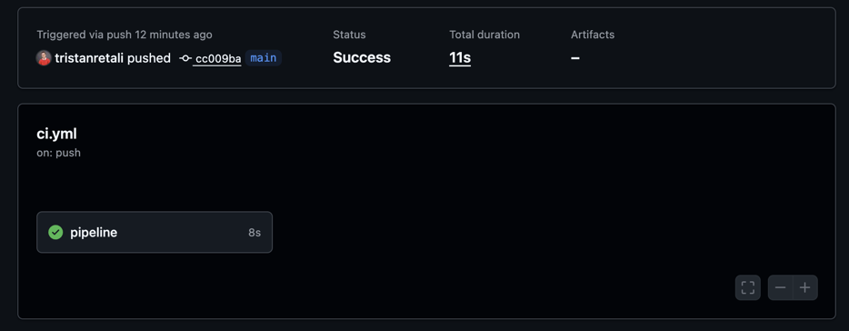
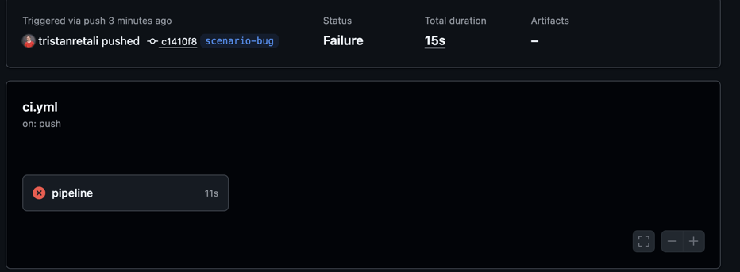
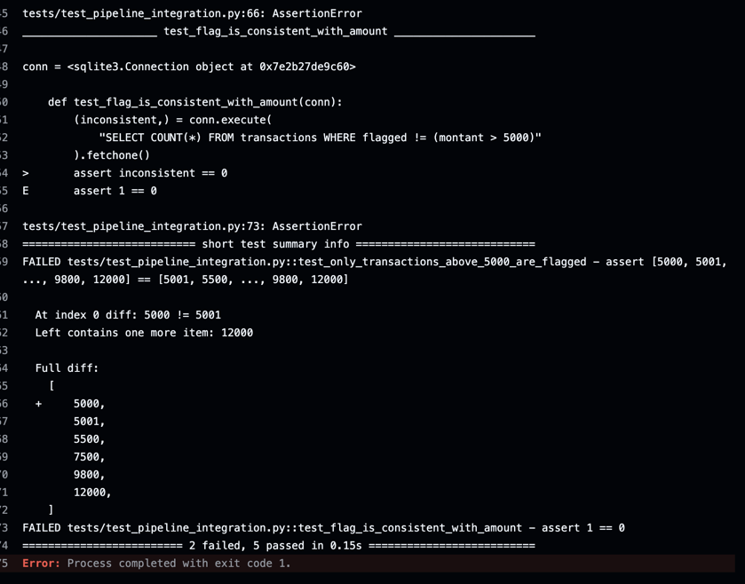
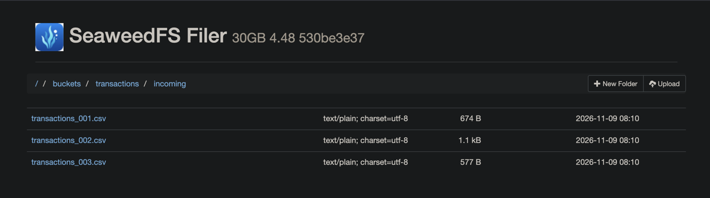
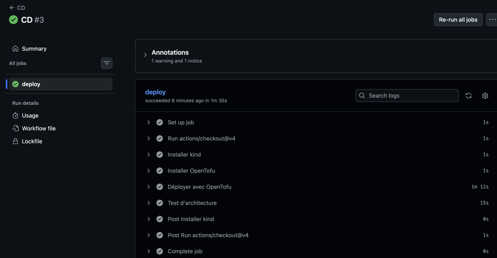
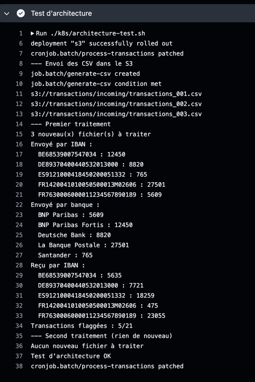
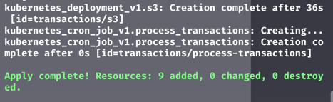

# Compte-rendu : mini projet CI/CD data

GitHub : <https://github.com/tristanretali/projet-CI-DE>

## 1. Architecture et choix techniques

| Besoin | Choix | Pourquoi |
| --- | --- | --- |
| Stockage des CSV | SeaweedFS (S3 local) | **SeaweedFS** démarre avec un seul conteneur alors que  **Garage** par exemple demande une étape d'initialisation en plus. |
| Cluster Kubernetes | kind | Il tourne dans Docker, donc pas besoin de VM ni de cloud. k3s demande une machine virtuelle et minikube est plus lourd pour une CI. |
| Infrastructure | OpenTofu | C'est la version libre de Terraform. Il décrit le cluster et tout ce qu'on déploie dedans. |

## 2. Niveau 1 : la pipeline de données

### Génération des CSV

Le script `src/generate_csv.py` crée 3 fichiers de 6, 10 et 5 transactions. Les données sont écrites en dur pour connaître à l'avance les résultats attendus et pouvoir les tester.

J'ai choisi des montants entiers car SQLite n'a pas de type décimal et qu'un nombre à virgule peut donner des erreurs d'arrondi dans les sommes. J'ai aussi mis des cas limites (4999, 5000 et 5001) pour tester le seuil du flag.

### Traitement

Le chargement des données (`loaders.py`) est séparé des fonctions de traitement (`transformations.py`) qui sont pures. Elles prennent des données et en renvoient d'autres, sans toucher à un fichier ou à la base de données. Elles calculent :

- la somme envoyée par IBAN d'origine;
- la somme envoyée par banque;
- la somme reçue par IBAN;
- un flag sur les transactions au-dessus de 5000.

Ces totaux sont calculés sur l'ensemble des transactions, tous fichiers confondus.

### Base de données

La base contient 5 tables :

- `transactions` : une ligne par transaction, avec ses informations (date, IBAN d'origine et de destination, pays, banque, montant) et le flag indiquant si le montant dépasse 5000
- `sent_by_iban` : le total envoyé par chaque IBAN d'origine
- `sent_by_bank` : le total envoyé par chaque banque
- `received_by_iban` : le total reçu par chaque IBAN
- `processed_files` : la liste des fichiers déjà traités, avec leur nom et leur hash

Toute l'insertion se fait dans une seule transaction SQL. Si quelque chose plante rien n'est enregistré et on ne se retrouve jamais avec des données à moitié écrites.

### Pipeline et tests d'intégration

La pipeline tourne sur GitHub Actions à chaque `push`. Elle lance un test d'intégration (`tests/test_pipeline_integration.py`) qui exécute la pipeline dans un dossier temporaire, puis vérifie le contenu de la base. C'est à dire le nombre de transactions, lesquelles sont flaggées et tous les totaux.



### Scénario d'échec

Pour montrer qu'une erreur est bien détectée, j'ai créé une branche `scenario-bug` où j'ai remplacé `>` par `>=` dans le flag. Une transaction de 5000 devient alors flaggée à tort, les tests le repèrent et la CI passe au rouge :





### Retry et anti-doublon

Pour l'insertion, j'ai écrit un décorateur `@retry` (`src/retry.py`). Il réessaie jusqu'à 3 fois en attendant 1 puis 2 secondes mais seulement pour les erreurs temporaires comme `database is locked`. Il ne réessaie pas pour une erreur qui reviendrait à l'identique comme un doublon.

Pour ne jamais traiter deux fois le même fichier même en cas de retry, chaque CSV est identifié par le hash SHA-256 de son contenu. Ce hash est enregistré dans `processed_files` au niveau de la transaction des données. Si l'insertion échoue, le fichier n'est pas enregistré et on retentera l'opération au prochain passage. Si elle réussit, il sera ignoré à tous les passages suivants même s'il est renommé. Les tests simulent une panne de la base pour vérifier tout ça.

## 3. Niveau 2 : le S3 local

Le S3 (SeaweedFS) est lancé avec `docker compose` au début de la pipeline. Le script de génération n'écrit plus de fichiers dans un dossier, il envoie les CSV dans le bucket `transactions` et le traitement les lit depuis ce bucket. L'interface web de SeaweedFS (`localhost:8888`) permet de les voir :



Comme le conteneur met quelques secondes à démarrer, le script attend que le S3 réponde avant d'envoyer les fichiers.

Pour la récupération des fichiers j'ai réutilisé le même `@retry`. Le téléchargement est retenté 3 fois en cas de problème réseau, d'erreur du serveur ou de fichier reçu incomplet. En revanche, un fichier introuvable ou un accès refusé n'est pas retenté puisque ça ne changerait rien.

Les tests utilisent chacun un bucket temporaire supprimé à la fin pour ne pas toucher aux vraies données.

## 4. Niveau 3 : le déploiement

### CD sur Kubernetes

Le script de traitement est mis dans une image Docker (`Dockerfile`) puis déployé dans un cluster Kubernetes avec :

- SeaweedFS avec un volume pour garder ses données
- un volume pour le fichier SQLite
- un `CronJob` qui lance le traitement toutes les 5 minutes. Comme il ne traite que les fichiers pas encore vus, un passage sans nouveu fichier ne fait rien.

Les serveurs de GitHub ne pouvant pas accéder à mon ordinateur. La CD crée donc un cluster **kind** jetable directement dans le runner, déploie dedans puis tout disparaît à la fin. Il se lance tout seul quand la CI passe entièrement sur `main`.



Avant de considérer le déploiement comme bon, un test d'architecture en local (`k8s/architecture-test.sh`) vérifie que tout fonctionne ensemble. iIl dépose les CSV dans le S3, lance un premier traitement, puis un second qui ne doit rien trouver de nouveau.



### OpenTofu

Tout ce déploiement est décrit en code dans le dossier `infra/`. Le cluster kind, la construction de l'image et tout ce qu'on déploie dedans, ce qui nous fait 9 ressources. Un seul `tofu apply` suffit pour créer ces ressources et avoir un système fonctionnel. J'avais d'abord écrit des fichiers YAML pour Kubernetes mais je les ai remplacés par OpenTofu pour éviter d'avpoir deux sourtces pour la même tâche.



## 5. Guide des commandes

À lancer depuis la racine du projet.

**Prérequis :** Docker, Python 3.14, `kubectl`, `kind` (version 0.33 ou plus) et OpenTofu.

**Installation**

```
python3 -m venv .venv
source .venv/bin/activate
pip install -r requirements.txt
```

**Lancer la pipeline en local**

```
./run_pipeline.sh
```

Ça démarre le S3, envoie les CSV dedans, les traitent et remplit la base `transaction.db`. Si on relance, le script répond « Aucun nouveau fichier à traiter ». Pour repartir de zéro.

```
rm transaction.db
docker compose down -v
```

**Lancer les tests**

```
docker compose up -d
pytest
```

**Déployer sur Kubernetes (kind) avec OpenTofu**

```
tofu -chdir=infra init
tofu -chdir=infra apply
./k8s/architecture-test.sh
```

Si un cluster nommé `transactions` existe déjà, il faut d'abord le supprimer avec `kind delete cluster --name transactions`. Le test d'architecture suppose un déploiement neuf.

**Voir les CSV dans le S3 du cluster**

```
kubectl --context kind-transactions -n transactions port-forward svc/s3 8889:8888
```

Puis ouvrir `http://localhost:8889`.

**Tout arrêter et nettoyer**

```
tofu -chdir=infra destroy
docker compose down -v
```